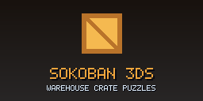
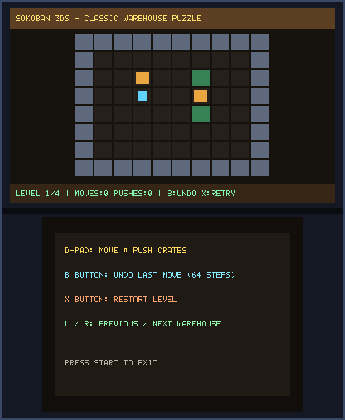
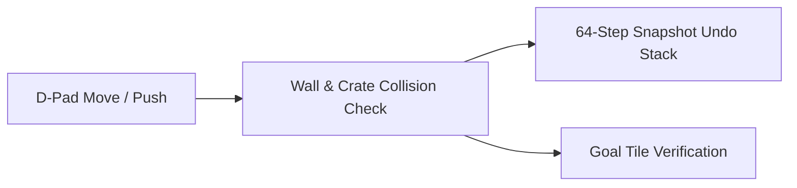

# Sokoban 3DS (`3ds_sokoban`)

<p align="center">
  
  &nbsp;&nbsp;&nbsp;
  
</p>

<p align="center">
  
</p>

> **Warehouse Crate Puzzles (`CTR-P-SOKO`, UniqueId `0x0D3ED`)** — Part of the [**lafiabrew**](https://github.com/orgs/lafiabrew/repositories) Nintendo 3DS Homebrew Suite.

Classic warehouse box-pushing logic puzzle with 64-step undo stack, move/push counters, and multiple warehouses.

---

## Architecture & Data Flow



---

## Controls & Touch Ergonomics

| Button / Input | Action |
|---|---|
| `D-Pad` | Move worker and push crates onto green goal tiles |
| `B` | Undo last move/push (up to 64 steps) |
| `X` | Restart current warehouse |
| `L` / `R` | Switch warehouse level |

---

## Build, Verify & Install

```bash
make test
make 3ds && make verify-3ds
make qr
```
